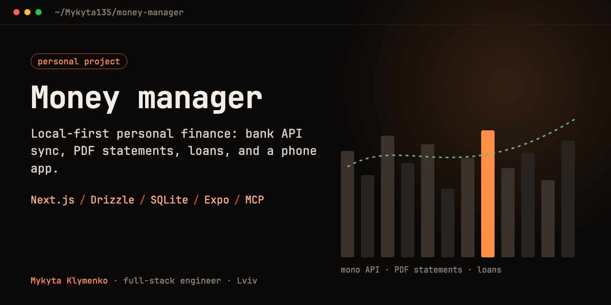

**In English.** A local-first money tracker I use daily. It syncs monobank through its API, parses Ukrsibbank PDF statements, tracks loans and instalments, categorises spending, detects subscriptions and runs monthly budgets. An Expo phone app reads bank push notifications so spending shows up without opening the bank app, and an MCP server lets Claude Code answer questions about my own money. Everything lives in one SQLite file (`data/money.db`) and never leaves the machine.

Stack: Next.js 16 + Drizzle + better-sqlite3 + Recharts, Expo / React Native, MCP SDK, Vitest (81 unit tests). My data, bank files, budget seeds and signing keys are not in this repo. The rest of this README is in Ukrainian.

> **About the git history.** Built in November 2026 for my own use and published as a single commit, so there is no earlier history here.

---

# Мої гроші

Локальний облік грошей: monobank (API), Укрсиббанк (PDF-виписка), кредити/розстрочки (вручну).
Все зберігається в `data/money.db` (SQLite) і нікуди не відправляється.

## Запуск

```bash
npm install
brew install poppler          # pdftotext — для PDF-виписок Укрсибу
cp .env.example .env.local    # і встав MONO_TOKEN з https://api.monobank.ua/
npm run db:push               # створити/оновити таблиці
npm run sync:mono             # перша синхронізація моно (~13 хв на рахунок за рік — ліміт API 1 запит/хв)
npm run dev                   # http://localhost:3000
```

Поки сервер працює, моно оновлюється сам кожні `MONO_SYNC_HOURS` годин (`src/instrumentation.ts`).

## Звідки дані

| Банк | Як | Де код |
|---|---|---|
| monobank | персональний API, інкрементально + догрузка історії по 31 добі | `src/lib/mono/` |
| Укрсиббанк | PDF «Виписка за картковим рахунком» з UKRSIB online → сторінка «Імпорт» | `src/lib/importers/ukrsib.ts` |
| ПУМБ | розстрочка вноситься вручну на сторінці «Кредити» | `src/lib/loans.ts` |

Повторний імпорт тієї ж виписки дублів не створює. Банківські файли тримай у `imports/` — папка в `.gitignore`.

## MCP для Claude Code

`.mcp.json` підключає локальний MCP-сервер `money` (`scripts/mcp-server.ts`), який працює з тією ж базою.
Інструменти: `overview`, `monthly_summary`, `spending_by_category`, `search_transactions`,
`set_category`, `mark_transfer`, `query_sql` (read-only SELECT), `mono_sync` (фонова синхронізація).
Токен моно лишається в `.env.local` і нікуди, крім api.monobank.ua, не йде.

## Бонуси й акції

Сторінка «Бонуси» (`/bonuses`): гаманець усіх бонусів, категорії кешбеку моно з оцінкою по реальних витратах
за 90 днів, акції й купони з датами, що згорає за 14 днів. Логіка — `src/lib/rewards.ts`.
Початкові дані — `npm run seed:bonuses`; далі оновлюються через MCP (`offer_upsert`, `reward_upsert`),
напр. щомісяця зі скрінів розділу «Кешбек» у моно.

## Тести

```bash
npm test                    # юніт (tests/unit) + регресія на реальних даних (tests/regression, пропускається без data/ та imports/)
cd mobile && npm run e2e -- -e MAC_URL=http://10.0.2.2:3001 -e TOKEN=<EXPORT_TOKEN>   # Maestro на емуляторі (потрібен npm run dev:lan)
```

- **Юніт:** цикл ЗП і правило 10k, перевитрата → менше «можна сьогодні», категорії, розстрочки/IRR, графік (Фенікс: моно до січня, ПУМБ до листопада 2027), OCR-розбір чеків, групи товарів, розбір пушів, сторож підписок.
- **Регресія:** суми з PDF Укрсибу = банківські «Разом» по кожній секції; снапшот сум по категоріях за рік (ловить зміни правил); відомі підписки знаходяться.
- **E2E (mobile/e2e):** імпорт з Mac → додати витрату → вона в операціях і в сповіщеннях; пуш банку → операція; «чи можу собі»; усі вкладки.

## Корисне

- `npm run recategorize` — перерахувати категорії після зміни правил у `src/lib/categories.ts`
- Перекази між власними рахунками (по номерах карток/рахунків) позначаються автоматично і не рахуються ні в дохід, ні у витрати — `src/lib/transfers.ts`
- Суми в БД — копійки (integer), час — unix seconds
